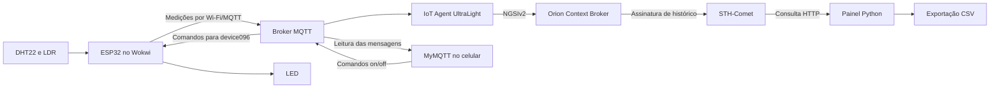
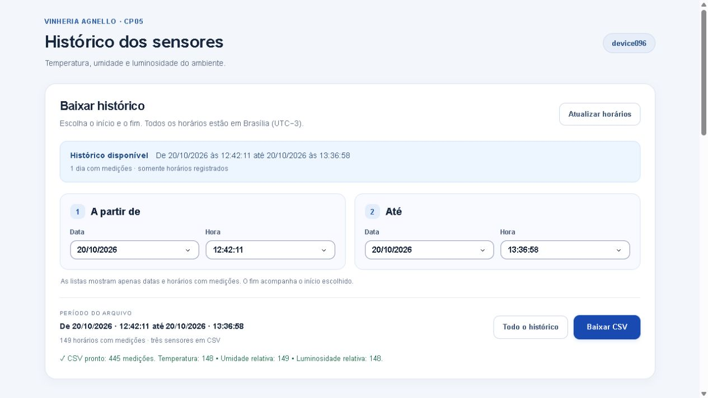
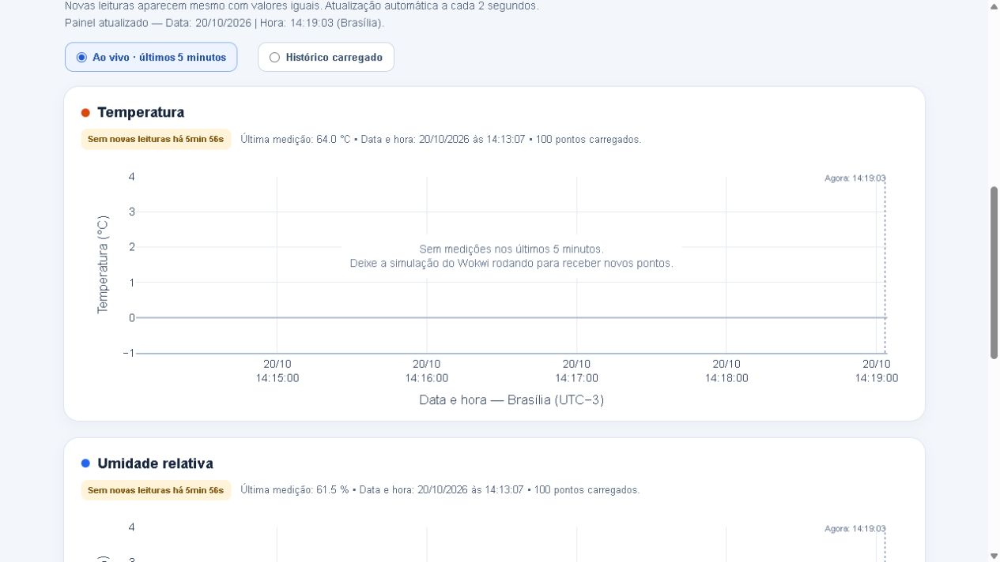

# Vinheria Agnello - IoT

**Checkpoint 05 — Edge Computing & Computer Systems | Engenharia de Software — FIAP**

Monitoramento de temperatura, umidade e luminosidade com ESP32, comunicação MQTT, armazenamento no FIWARE e visualização em um painel com exportação de histórico. O LED pode ser ligado e desligado pelo celular usando o MyMQTT.

[Abrir simulação no Wokwi](https://wokwi.com/projects/478344826703588353) · [Repositório no GitHub](https://github.com/Gabriel-Finzetto/Vinheria-Agnello---IoT)

## Sumário

- [Descrição do projeto](#descrição-do-projeto)
- [Estratégia de desenvolvimento](#estratégia-de-desenvolvimento)
- [Regras de preservação](#regras-de-preservação)
- [Hardware e materiais](#hardware-e-materiais)
- [Esquema de ligações](#esquema-de-ligações)
- [Arquitetura e fluxo dos dados](#arquitetura-e-fluxo-dos-dados)
- [Tecnologias e pré-requisitos](#tecnologias-e-pré-requisitos)
- [Organização dos arquivos](#organização-dos-arquivos)
- [Configurações da integração](#configurações-da-integração)
- [Como reproduzir o projeto](#como-reproduzir-o-projeto)
- [Soluções adotadas](#soluções-adotadas)
- [Testes e evidências](#testes-e-evidências)
- [Limitações e problemas comuns](#limitações-e-problemas-comuns)
- [Links de acesso](#links-de-acesso)
- [Equipe](#equipe)

## Descrição do projeto

A Vinheria Agnello precisa acompanhar as condições de armazenamento de seus vinhos e consultar como elas variam ao longo do tempo. Medições isoladas ajudam a identificar o estado atual; o histórico permite analisar períodos, comparar condições e elaborar relatórios de rastreabilidade.

O projeto utiliza um ESP32 para ler os sensores e enviar as medições pela internet. O FIWARE recebe e organiza os dados; o STH-Comet mantém o histórico disponível para consulta. Um painel em Python apresenta três gráficos e permite baixar os registros de um intervalo escolhido em CSV, que pode ser aberto no Excel.

A solução também demonstra comunicação de retorno: pelo aplicativo MyMQTT no celular, o usuário acompanha as mensagens e envia comandos para o LED conectado ao ESP32.

## Estratégia de desenvolvimento

O desenvolvimento foi dividido em etapas para validar cada parte do caminho dos dados:

1. **Montagem e leitura:** conectar ESP32, DHT22, LDR e LED no Wokwi e conferir as leituras no Monitor Serial.
2. **Comunicação:** conectar o ESP32 ao Wi-Fi, sincronizar o relógio e publicar as medições por MQTT.
3. **Integração com FIWARE:** cadastrar o dispositivo no IoT Agent e consultar seus atributos no Orion.
4. **Histórico:** configurar a assinatura que encaminha as medições do Orion para o STH-Comet.
5. **Controle pelo celular:** testar leitura e comandos de ligar/desligar o LED no MyMQTT.
6. **Visualização e exportação:** consultar o histórico, atualizar os gráficos automaticamente e gerar um CSV por data e hora.

### Simulação e montagem física

| Ambiente | Estratégia |
| --- | --- |
| Wokwi | ESP32 com DHT22 para temperatura/umidade, módulo LDR para luminosidade e LED com resistor. |
| Enunciado do CP05 | Especifica ESP32, DHT11 e LDR. A simulação utiliza DHT22; essa adaptação deve ser validada com o professor. |
| Montagem física | Exige conferir o modelo efetivamente utilizado, sua alimentação e a configuração da biblioteca. A validação registrada neste projeto foi feita no simulador. |

O firmware foi adaptado da base fornecida na disciplina, preservando os créditos do código original. As configurações de identificação, servidor e intervalo de leitura ficam concentradas no início do sketch.

## Regras de preservação

As referências abaixo vêm do enunciado do CP05 e orientam a análise das condições da adega.

| Tema | Referência de preservação | Como o projeto acompanha |
| --- | --- | --- |
| **Temperatura** | Manter temperatura estável, próxima de **13 °C**. O enunciado destaca que flutuações acima de **3 °C** podem prejudicar o vinho. | O DHT22 fornece a temperatura em °C; o gráfico e o CSV permitem acompanhar as variações. |
| **Umidade** | Manter próxima de **70%**, com referência entre **60% e 80%**, reduzindo problemas com rolhas, rótulos e fungos. | O DHT22 fornece a umidade relativa em porcentagem. |
| **Luminosidade** | Manter iluminação suave, favorecendo ambientes com pouca exposição à luz. | O LDR fornece luminosidade **relativa de 0 a 100%**: valores menores representam ambiente mais escuro. |

A variação de 3 °C é uma orientação sobre estabilidade térmica, e não uma faixa automática de 13 °C ± 3 °C. O enunciado não define um limite numérico de luminosidade para esta versão. O LDR também não mede diretamente a exposição ultravioleta.

### Funcionamento do LED

O LED é **controlado pelo usuário no celular, pelo MyMQTT**. Um comando liga o LED e outro o desliga; o ESP32 informa o estado pelo MQTT.

As referências de conservação orientam a leitura dos sensores e a análise do histórico. Nesta versão, a decisão de ligar ou desligar o LED é manual, pelos comandos do aplicativo.

## Hardware e materiais

| Quantidade | Componente | Função |
| --- | --- | --- |
| 1 | ESP32 DevKit C V4 | Leitura dos sensores, conexão Wi-Fi e comunicação MQTT. |
| 1 | DHT22 | Temperatura e umidade relativa na simulação. |
| 1 | Módulo LDR com saída analógica AO | Leitura da luminosidade. |
| 1 | LED vermelho | Demonstrar o controle remoto pelo celular. |
| 1 | Resistor de 220 Ω | Limitar a corrente do LED. |
| Conforme a montagem | Fios/jumpers | Interligar alimentação e sinais. |

Para uma montagem física, também são necessários alimentação adequada, cabo USB e os materiais de conexão correspondentes. No Wokwi, os componentes são simulados e o projeto pode ser executado no navegador.

## Esquema de ligações

| Componente | Pino do componente | Ligação no ESP32 |
| --- | --- | --- |
| DHT22 | VCC | 3V3 |
| DHT22 | SDA/DATA | GPIO **15** |
| DHT22 | GND | GND |
| DHT22 | NC | Sem conexão |
| Módulo LDR | VCC | 3V3 |
| Módulo LDR | GND | GND |
| Módulo LDR | AO | GPIO **34** |
| Módulo LDR | DO | Sem conexão |
| LED | Ânodo — A | GPIO **2** |
| LED | Cátodo — C | Resistor de **220 Ω**, em série até o GND |

Os componentes compartilham o GND do ESP32. Os nomes dos pinos podem ser conferidos diretamente no simulador. A montagem está salva em [firmware/diagram.json](firmware/diagram.json).

## Arquitetura e fluxo dos dados



- **MQTT:** transporta as medições e os comandos.
- **IoT Agent:** interpreta a mensagem UltraLight e atualiza a entidade no FIWARE.
- **Orion:** disponibiliza o estado atual dos atributos por NGSIv2.
- **STH-Comet:** armazena o histórico encaminhado pela assinatura do Orion.
- **Painel:** consulta os registros, apresenta os gráficos e prepara o CSV.
- **Postman:** configura e confere as APIs. Após a configuração, o histórico continua funcionando com o Postman fechado, enquanto o servidor recebe medições.

## Tecnologias e pré-requisitos

| Tecnologia | Uso |
| --- | --- |
| Wokwi | Simular a montagem e executar o firmware do ESP32. |
| C++/Arduino, WiFi, PubSubClient e DHTesp | Leitura dos sensores e comunicação do ESP32. As bibliotecas do simulador estão em `firmware/libraries.txt`. |
| MQTT e UltraLight 2.0 | Enviar atributos e receber comandos. |
| FIWARE — IoT Agent, Orion e STH-Comet | Integrar o dispositivo, consultar atributos e armazenar histórico. |
| Postman | Executar as requisições da coleção do projeto. |
| MyMQTT | Ler mensagens e controlar o LED pelo celular. |
| Python 3.10 ou superior | Executar o painel local. |
| Dash 4.4.1, Plotly 6.9.0 e Requests 2.34.2 | Interface, gráficos e consultas HTTP. Versões declaradas em [requirements.txt](requirements.txt). |

São necessários acesso à internet, um navegador e disponibilidade do servidor FIWARE. O roteiro utiliza o ambiente fornecido pelo professor; a instalação de um servidor FIWARE próprio não faz parte deste repositório.

## Organização dos arquivos

```text
cp-5/
├── README.md
├── .gitignore
├── firmware/
│   ├── sketch.ino                      # Código do ESP32
│   ├── diagram.json                    # Montagem do Wokwi
│   └── libraries.txt                   # Bibliotecas do simulador
├── fiware/
│   └── device096.postman_collection.json
├── assets/
│   └── painel.css                      # Aparência do painel
├── painel_historico_device096.py        # Gráficos e interface
├── exportar_historico.py                # Consulta paginada e CSV
├── iniciar_painel.bat                   # Inicialização no Windows
├── requirements.txt
├── validacao-exportacao.json            # Registro dos testes
├── painel-exportacao-validada.jpg       # Evidência da exportação
└── painel-tempo-real-validado.jpg       # Evidência do monitoramento
```

A pasta `.venv` é criada localmente para as dependências Python e fica fora do versionamento, assim como os arquivos de cache.

## Configurações da integração

### Identificação e endereços

| Configuração | Valor utilizado |
| --- | --- |
| Servidor do professor | `3.135.234.101` |
| Broker MQTT | Porta `1883` |
| IoT Agent | Porta `4041` |
| Orion | Porta `1026` |
| STH-Comet | Porta `8666` |
| Dispositivo | `device096` |
| Entidade no Orion | `urn:ngsi-ld:device:096` |
| Tipo da entidade | `device` |
| `fiware-service` | `smart` |
| `fiware-servicepath` | `/` |
| Chave de integração | `TEF` |
| Client ID do ESP32 | `fiware_096` |
| Wi-Fi no Wokwi | `Wokwi-GUEST`, com senha vazia |
| Painel local | `http://127.0.0.1:8050` |

Use uma única simulação com o Client ID `fiware_096`. No celular, utilize outro Client ID, como `mymqtt096-1`. Para outro grupo/dispositivo, ajuste de forma consistente o firmware, o cadastro, os tópicos, a entidade, a assinatura e os dois programas Python.

### Atributos e tópicos MQTT

| Atributo | Informação | Unidade/formato |
| --- | --- | --- |
| `t` | Temperatura | °C |
| `h` | Umidade relativa | % |
| `p` | Luminosidade relativa | 0 a 100% |
| `s` | Estado do LED | `on` ou `off` |

| Finalidade | Tópico |
| --- | --- |
| Receber medições e estado do LED | `/TEF/device096/attrs` |
| Enviar comandos para o ESP32 | `/TEF/device096/cmd` |

Exemplo do formato de uma mensagem de teste:

```text
2026-10-20T17:13:07Z|p|90|t|64.0|h|61.5
```

O exemplo representa o formato da mensagem, não uma condição adequada de conservação. O `Z` indica horário UTC. O Monitor Serial e o painel apresentam o horário de Brasília, UTC−3. As mensagens de estado do LED aparecem separadamente como `s|on` ou `s|off`.

O firmware configura leituras com intervalo de 2 segundos. Esse intervalo é ajustável em `INTERVALO_LEITURA_MS`, respeitando o mínimo adotado para o DHT22. O painel consulta o servidor a cada 2 segundos, configurados em `REFRESH_MS`; são configurações independentes.

## Como reproduzir o projeto

**Fluxo:** preparar a montagem → configurar FIWARE → executar o ESP32 → testar o celular → abrir os gráficos → baixar o histórico.

### 1. Preparar o Wokwi

1. Abra a [simulação do projeto](https://wokwi.com/projects/478344826703588353).
2. Confira a montagem e os arquivos `sketch.ino`, `diagram.json` e `libraries.txt`. Uma cópia desses arquivos está em [firmware](firmware).
3. Para criar outra simulação, use um projeto ESP32 no Wokwi e copie o conteúdo dos três arquivos para as abas correspondentes.
4. Confira servidor, identificação `device096` e os pinos **15, 34 e 2** no código. O firmware configura o Monitor Serial em **115200 baud**.

### 2. Conferir o cadastro no FIWARE pelo Postman

1. Importe [fiware/device096.postman_collection.json](fiware/device096.postman_collection.json) no Postman.
2. Na coleção, confira a variável `servidor`, inicialmente `3.135.234.101`. Use **No Auth**, conforme o ambiente disponibilizado.
3. Execute **Consultar grupo TEF** e confira a existência do grupo no serviço `smart` e caminho `/`.
4. Execute **Consultar cadastro device096**. Se retornar **200**, reutilize o cadastro. Se retornar **404**, execute **Cadastrar device096 — somente se ausente**; a resposta esperada é **201 Created**.

A coleção configura os atributos `p`, `t`, `h` e `s`, os comandos `on`/`off`, transporte MQTT e `timestamp: true`. O grupo TEF compartilhado é reutilizado.

### 3. Ativar o armazenamento histórico

1. Execute **Conferir assinaturas**.
2. Procure uma assinatura ativa da entidade `urn:ngsi-ld:device:096`, com os atributos `p`, `t` e `h`, encaminhados para `http://3.135.234.101:8666/notify`.
3. Se essa assinatura já existir, continue. Se estiver ausente, execute **Ativar histórico — executar uma vez**. A resposta esperada é **201 Created**; guarde o endereço retornado no cabeçalho `Location`.

O histórico passa a receber novas medições após a ativação. As requisições POST de cadastro e assinatura são executadas apenas quando esses recursos estiverem ausentes.

### 4. Iniciar a coleta e conferir os dados

1. Clique em **Play** no Wokwi e mantenha a simulação rodando.
2. No Monitor Serial, acompanhe a conexão Wi-Fi/MQTT, a sincronização da data/hora e o envio das leituras.
3. No Postman, execute **Consultar medições no Orion** e confira os valores `p`, `t`, `h` e o `TimeInstant` de cada atributo.
4. Execute as consultas de histórico de temperatura, umidade e luminosidade. Procure registros em `values`, com `recvTime` e `attrValue`.

Leituras com valores iguais também podem gerar novos registros, pois possuem timestamps diferentes. Uma resposta HTTP 200 com `values` vazio indica uma consulta válida sem amostras disponíveis naquela resposta.

### 5. Ler dados e controlar o LED pelo celular

Abra o MyMQTT e crie uma conexão:

| Campo | Preenchimento |
| --- | --- |
| Nome | `Vinheria Agnello - device096` |
| Host/Broker | `3.135.234.101`, sem `http://` |
| Porta | `1883` |
| Protocolo, se solicitado | MQTT 3.1.1 |
| Usuário e senha | Em branco, conforme a configuração atual do servidor |
| TLS/SSL | Desativado, conforme a conexão utilizada neste ambiente |
| Client ID, se solicitado | `mymqtt096-1`, diferente do ESP32 |

Depois de conectar:

1. Em **Subscribe/Assinaturas**, adicione `/TEF/device096/attrs`. As medições enviadas pelo ESP32 devem aparecer no celular.
2. Em **Publish/Publicar**, use o tópico `/TEF/device096/cmd`, **QoS 0** e **Retain desmarcado**, se essas opções aparecerem.
3. Para ligar o LED, publique:

   ```text
   device096@on|
   ```

4. Para desligar, publique:

   ```text
   device096@off|
   ```

5. Observe o LED no Wokwi e o retorno `s|on` ou `s|off` no aplicativo. Aguarde o processamento do ciclo do ESP32.

A barra vertical final faz parte do comando. Copie as mensagens sem aspas.

### 6. Executar o painel no computador

**No Windows:**

1. Instale Python 3.10 ou superior, caso ainda não esteja disponível.
2. Na pasta do projeto, dê dois cliques em `iniciar_painel.bat`. O iniciador prepara as dependências quando necessário.
3. Mantenha essa janela aberta e acesse [http://127.0.0.1:8050](http://127.0.0.1:8050) no navegador.

**Alternativa pelo terminal, dentro da pasta do projeto:**

```powershell
python -m venv .venv
.venv\Scripts\python.exe -m pip install -r requirements.txt
.venv\Scripts\python.exe painel_historico_device096.py
```

Em **Ao vivo · últimos 5 minutos**, o eixo acompanha o relógio e os novos pontos são carregados automaticamente. Valores constantes formam uma linha horizontal. Em **Histórico carregado**, é possível visualizar os pontos anteriores mantidos na aba.

Para testar variações, clique no DHT22 ou no LDR no Wokwi e altere os controles. Para testar continuidade, deixe os valores constantes e observe novos horários de medição. Após 10 segundos sem novas amostras, o painel apresenta **Sem novas leituras**. O relógio do painel continua avançando e o horário da última medição permanece identificado.

### 7. Baixar o histórico por data e hora

1. Em **Baixar histórico**, confira o intervalo disponível.
2. Em **A partir de**, selecione a **Data** e a **Hora** inicial.
3. Em **Até**, escolha a **Data** e a **Hora** final. As listas oferecem apenas instantes com medições, e o fim respeita o início escolhido.
4. Confira o resumo **Período do arquivo** e clique em **Baixar CSV**.
5. Abra o arquivo no Excel. Ele contém timestamp UTC, data/hora de Brasília, atributo, sensor, valor, unidade e identificador do registro quando disponível.

**Todo o histórico** seleciona o primeiro e o último registro disponíveis. **Atualizar horários** consulta novas opções imediatamente; a lista também é atualizada automaticamente a cada minuto. O intervalo inclui os dois instantes selecionados, e cada linha corresponde à medição de um sensor.

O CSV usa UTF-8 com BOM, separador `;` e decimal com vírgula. Se o Excel não separar as colunas, use **Dados → De Texto/CSV**, com UTF-8 e delimitador ponto e vírgula.

## Soluções adotadas

| Solução | Aplicação no projeto |
| --- | --- |
| Simulação acessível | A montagem e o firmware podem ser executados no navegador pelo Wokwi. |
| Leitura conjunta | Temperatura, umidade e luminosidade são enviadas na mesma mensagem MQTT com timestamp. |
| Relógio sincronizado | NTP fornece a referência UTC; a apresentação é convertida para Brasília. |
| Comunicação bidirecional | O ESP32 publica as medições e recebe os comandos enviados pelo celular. |
| Histórico desacoplado do painel | O servidor mantém os registros recebidos pela assinatura; abrir ou fechar o painel não define a coleta no servidor. |
| Gráficos independentes | Cada sensor tem sua própria série, unidade e cor. Leituras iguais com timestamps diferentes são preservadas. |
| Atualização automática | Consulta configurada para 2 segundos, relógio avançando e indicação de ausência de novas leituras. |
| Exportação paginada | A consulta percorre as páginas do período selecionado, além dos pontos recentes visíveis no gráfico. |
| Seleção de períodos válidos | Datas e horas vêm dos registros existentes; falhas de consulta bloqueiam a exportação em vez de entregar um arquivo parcial. |
| Interface legível | Campos separados para data/hora, resumo do período, bordas arredondadas e linhas mais grossas nos gráficos. |

### Atendimento aos requisitos do CP05

| Requisito | Situação desta versão |
| --- | --- |
| ESP32, Wi-Fi e publicação MQTT | Implementado na simulação. |
| Temperatura, umidade e luminosidade | Implementado com DHT22 e LDR. A adequação do DHT22 ao enunciado que pede DHT11 precisa ser validada com o professor. |
| Timestamp das leituras | Implementado no envio e preservado no histórico. |
| Backend FIWARE e NGSIv2 | Implementado com IoT Agent e Orion. O STH utiliza a interface/formato de compatibilidade do ambiente fornecido. |
| Armazenamento e exportação de histórico | Implementados para os registros realmente disponíveis no servidor. |
| Leitura e escrita pelo MyMQTT | Funcionamento confirmado pelo grupo durante os testes. |
| Smart Data Models | **Pendente de adequação a um modelo oficial.** O tipo `device` com atributos `p/t/h` em NGSIv2, por si só, não comprova essa conformidade. |

## Testes e evidências

| Teste | Resultado esperado |
| --- | --- |
| Modificar o DHT22 no Wokwi | Temperatura e umidade alteradas aparecem no MQTT, no Orion e no histórico. |
| Modificar o LDR | A luminosidade relativa varia entre escuro e claro. |
| Manter os valores dos sensores constantes | Novas medições aparecem com timestamps diferentes. |
| Enviar `device096@on|` e `device096@off|` pelo celular | O LED liga/desliga e seu estado retorna pelo tópico de atributos. |
| Manter o painel aberto | O relógio e o eixo ao vivo avançam automaticamente. |
| Interromper o envio do ESP32 | O painel identifica a ausência de novas leituras, preservando o horário da última medição. |
| Selecionar um intervalo e baixar o CSV | O arquivo contém as medições reais dos três sensores existentes no período. |

Em uma validação realizada em **20/10/2026**, a exportação retornou **445 registros**: 148 de temperatura, 149 de umidade e 148 de luminosidade. Os números correspondem àquele teste e podem crescer com novas medições. Também foram conferidos timestamps, conversão para Brasília, paginação, bloqueio de períodos inválidos e atualização do relógio sem criação de amostras artificiais.

O registro dos testes está em [validacao-exportacao.json](validacao-exportacao.json).

**Exportação por período:**



**Monitoramento ao vivo e indicação de ausência de novas leituras:**



## Limitações e problemas comuns

### Limitações conhecidas

- O histórico contém somente dados efetivamente gravados e ainda retidos no servidor. Sua ativação não recupera medições anteriores, e selecionar um período não cria registros ausentes.
- O painel busca até **100 registros por consulta** e mantém até **500 pontos por sensor** na aba aberta. O CSV consulta o período completo disponível por paginação.
- A luminosidade é um **percentual relativo**, calculado a partir do sinal analógico; a escala não corresponde a uma calibração em lux.
- A simulação usa DHT22. A montagem física e a substituição pelo DHT11 exigem conferência e validação.
- A adequação a Smart Data Models permanece pendente, conforme a tabela de requisitos.
- Novas medições dependem da simulação em execução e da conexão com o servidor. Os registros existentes continuam consultáveis com o Wokwi parado, enquanto o STH estiver disponível.

### Se algo não funcionar

| Situação | O que conferir |
| --- | --- |
| Não chegam mensagens no MyMQTT | Wokwi em execução, conexão ao broker, IP/porta e tópico `/TEF/device096/attrs`. |
| O LED não responde | Conexão do celular, tópico `/TEF/device096/cmd`, mensagem exata com a barra final e Client IDs diferentes. |
| O sensor DHT22 falha | Alimentação, GND, DATA no GPIO 15 e configuração `DHTesp::DHT22`. |
| O firmware aguarda data/hora | Conexão de rede e sincronização NTP. O envio exige um horário válido. |
| O Orion mostra valores, mas o histórico está vazio | Assinatura ativa para a entidade e atributos corretos; medições enviadas após a ativação; resultado da notificação ao STH. |
| Aparece “Sem novas leituras” | O timestamp não está avançando. Confira o envio do ESP32; alterar manualmente o valor do sensor não é necessário para publicar novas amostras. |
| O gráfico ao vivo fica sem pontos | Não há medições na janela dos últimos 5 minutos. Mantenha o Wokwi rodando ou escolha **Histórico carregado** para consultar os pontos anteriores. |
| O CSV não é gerado | Disponibilidade do servidor e horários selecionados. Clique em **Atualizar horários** se os registros tiverem mudado. |
| A porta 8050 já está em uso | Feche a instância anterior do painel e execute o iniciador novamente. |
| O servidor fornecido mudou de IP | Atualize a variável da coleção Postman, o broker no firmware/MyMQTT e os endereços dos dois arquivos Python. |

## Links de acesso

- [Simulação atual no Wokwi](https://wokwi.com/projects/478344826703588353)
- [Repositório deste projeto no GitHub](https://github.com/Gabriel-Finzetto/Vinheria-Agnello---IoT)
- [Los Vinheteiros — projeto anterior utilizado como referência de organização](https://github.com/Gabriellluna/Los-Vinheteiros)
- [MyMQTT](https://mymqtt.app/en)
- [Documentação de histórico do STH-Comet](https://fiware-sth-comet.readthedocs.io/en/latest/raw-data-retrieval.html)
- [Atualização automática no Dash](https://dash.plotly.com/live-updates)
- [Smart Data Models](https://smartdatamodels.org/)

## Equipe

| Integrante | RM |
| --- | --- |
| **Bruno Guilherme Gonçalves de Oliveira** | **573697** |
| **Gabriel Cardoso de Sá Finzetto** | **571846** |
| **Gabriel Luna Maia** | **570982** |
| **João Lucas Magordo Rodrigues** | **572419** |
| **Murilo Vieira dos Reis** | **573764** |

Projeto acadêmico — FIAP, 2026. Desenvolvido a partir do enunciado da Vinheria Agnello e dos materiais da disciplina. O firmware preserva os créditos de Fábio Henrique Cabrini e Lucas Demetrius Augusto.
