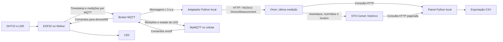

# Vinheria Agnello - IoT

**Checkpoints 05 — Edge Computing & Computer Systems | Engenharia de Software — FIAP**

Monitoramento de temperatura, umidade e luminosidade com ESP32, comunicação MQTT, padronização das medições em Smart Data Models e armazenamento no FIWARE. Um painel local apresenta as leituras e exporta o histórico por data e hora. O LED é controlado pelo celular com o MyMQTT.

[Abrir simulação no Wokwi](https://wokwi.com/projects/478344826703588353) · [Repositório no GitHub](https://github.com/Gabriel-Finzetto/Vinheria-Agnello---IoT) · [Arquivos na branch Main](https://github.com/Gabriel-Finzetto/Vinheria-Agnello---IoT/tree/main)

## Sumário

- [Descrição do projeto](#descrição-do-projeto)
- [Estratégia de desenvolvimento](#estratégia-de-desenvolvimento)
- [Smart Data Models e regras dos dados](#smart-data-models-e-regras-dos-dados)
- [Hardware e materiais](#hardware-e-materiais)
- [Esquema de ligações](#esquema-de-ligações)
- [Arquitetura e fluxo dos dados](#arquitetura-e-fluxo-dos-dados)
- [Tecnologias e pré-requisitos](#tecnologias-e-pré-requisitos)
- [Organização dos arquivos](#organização-dos-arquivos)
- [Configurações da integração](#configurações-da-integração)
- [Como reproduzir o projeto](#como-reproduzir-o-projeto)
- [Soluções adotadas](#soluções-adotadas)
- [Testes e validação](#testes-e-validação)
- [Limitações e problemas comuns](#limitações-e-problemas-comuns)
- [Links de acesso](#links-de-acesso)
- [Equipe](#equipe)

## Descrição do projeto

A Vinheria Agnello precisa acompanhar as condições de armazenamento de seus vinhos e consultar como elas variam ao longo do tempo. A leitura atual mostra o estado do ambiente; o histórico permite analisar períodos, comparar variações e elaborar relatórios de rastreabilidade.

O ESP32 lê os sensores e publica as medições por MQTT. Um adaptador Python recebe essas mensagens e organiza cada grandeza em uma entidade `DeviceMeasurement` no Orion Context Broker. Uma assinatura encaminha as novas medições ao STH-Comet, responsável pelo histórico. O painel consulta esses serviços e apresenta três gráficos, além da exportação em CSV.

A solução também permite comunicação de retorno: pelo MyMQTT, o usuário acompanha as mensagens e envia comandos para ligar ou desligar o LED. O controle é manual e demonstra a troca de informações entre celular e ESP32.

## Estratégia de desenvolvimento

O projeto evoluiu da comunicação do dispositivo com o servidor para uma solução com consulta atual, histórico e visualização própria. Cada etapa foi organizada para conferir uma parte do percurso dos dados:

1. **Montagem e leitura:** conectar ESP32, DHT22, LDR e LED no Wokwi e validar os sinais no Monitor Serial.
2. **Comunicação:** conectar o ESP32 ao Wi-Fi, sincronizar o relógio por NTP e publicar as três medições na mesma mensagem MQTT.
3. **Padronização:** manter o envio `t/h/p` do firmware e fazer a correspondência com `DeviceMeasurement` no adaptador Python. Essa escolha concentra a transformação dos dados na integração e mantém o formato de envio do firmware atual.
4. **Armazenamento:** configurar a assinatura das três entidades no Orion para gravar as medições no STH-Comet com seu horário original.
5. **Controle pelo celular:** receber mensagens e testar os comandos de ligar e desligar o LED pelo MyMQTT.
6. **Visualização:** consultar a última medição no Orion e os registros recentes no STH, mantendo uma janela ao vivo de cinco minutos.
7. **Exportação:** oferecer somente datas e horários registrados e consultar todas as páginas do período selecionado para gerar o CSV.

### Adaptação do sensor e do código original

O enunciado utiliza DHT11. Na simulação foi adotado o **DHT22**, disponível no projeto do Wokwi, para realizar as mesmas leituras de temperatura e umidade. O firmware e o esquema de ligações deste repositório estão configurados para DHT22; essa substituição precisa ser considerada na avaliação da adaptação ao enunciado.

A adaptação mantém a estrutura de conexão Wi-Fi/MQTT e o controle do LED da base fornecida na disciplina. Foram ajustados o grupo/dispositivo, o servidor e os tópicos correspondentes. A leitura de luminosidade, antes publicada separadamente em um tópico terminado em `/attrs/p`, passou a integrar a mensagem conjunta com temperatura, umidade e timestamp em `/TEF/device096/attrs`.

Também foram acrescentados o DHT22, a sincronização de horário por NTP e o intervalo ajustável. O mapeamento analógico da luminosidade foi invertido para representar menos luz com percentual menor e mais luz com percentual maior no módulo utilizado. A padronização, o painel e a exportação ficam em programas Python separados. Os créditos do código original foram mantidos.

## Smart Data Models e regras dos dados

O projeto utiliza o modelo **DeviceMeasurement** para identificar o significado de cada medição. Essa padronização organiza valores, grandezas, unidades, dispositivo e horário para que outros sistemas possam interpretar os registros.

### Definições do modelo

O [schema oficial de DeviceMeasurement](https://github.com/smart-data-models/dataModel.Device/blob/master/DeviceMeasurement/schema.json) exige `id` e `type`, com `type` igual a `DeviceMeasurement`. Os demais campos utilizados neste projeto são opcionais no modelo; foram escolhidos para descrever as leituras:

| Campo do modelo | Definição | Uso no projeto |
| --- | --- | --- |
| `id` | Identificador da entidade. | Um ID para a série de cada grandeza do dispositivo 096. |
| `type` | Tipo da entidade: `DeviceMeasurement`. | O mesmo tipo para as três séries. |
| `controlledProperty` | Texto que identifica a propriedade observada. | `temperature`, `relativeHumidity` ou `relativeLightLevel`. |
| `numValue` | Valor numérico da medição. | Leitura enviada pelo ESP32. |
| `unit` | Texto que identifica a unidade; para abreviações, o modelo orienta utilizar códigos UN/CEFACT. | `CEL` para °C e `P1` para %. |
| `dateObserved` | Data e hora da observação em ISO 8601 UTC. | Timestamp produzido pelo firmware e normalizado pelo adaptador. |
| `refDevice` | Identificador do dispositivo de origem. | `urn:ngsi-ld:device:096`. |

Os nomes `temperature`, `relativeHumidity` e `relativeLightLevel` são o vocabulário adotado no projeto. O schema aceita texto em `controlledProperty` e não impõe essa lista. Os códigos de unidade utilizados correspondem a graus Celsius e porcentagem na [referência UN/CEFACT](https://service.unece.org/trade/uncefact/vocabulary/rec20/).

### Regras implementadas no adaptador

As validações abaixo vêm de [adaptador_smart_data_models.py](adaptador_smart_data_models.py). Elas descrevem o tratamento das mensagens nesta aplicação e são distintas das exigências do schema.

| Regra da implementação | Tratamento |
| --- | --- |
| Mensagem de medição completa | Exigir timestamp com fuso e uma ocorrência de cada campo `t`, `h` e `p`. |
| Valores numéricos | Aceitar somente números finitos nos três campos. |
| Percentuais | Exigir `h` e `p` entre 0 e 100, inclusive. |
| Temperatura | Validar como número finito; nenhuma faixa de conservação é aplicada pelo adaptador. |
| Horário | Normalizar o timestamp recebido para UTC. |
| Mensagens retidas | Ignorar publicações marcadas como retidas pelo broker. |
| Ordem das leituras | Ignorar timestamps iguais ou anteriores ao último envio bem-sucedido da execução. |
| Estado do LED | Tratar as publicações de estado separadamente das medições dos sensores. |
| Identificação das séries | Atualizar os mesmos três IDs no Orion; o histórico das observações fica no STH-Comet. |

O metadado `numValue.metadata.TimeInstant` foi adotado para associar o horário ao valor na integração com o STH-Comet. Ele não é uma exigência de `DeviceMeasurement`. As faixas dos percentuais, a quantidade de entidades e o formato dos IDs também são escolhas desta implementação.

### Correspondência entre MQTT e modelo

A cada mensagem válida de medição, o adaptador faz a correspondência:

| Campo no MQTT | `controlledProperty` | `unit` | Apresentação |
| --- | --- | --- | --- |
| `t` | `temperature` | `CEL` | Temperatura em °C |
| `h` | `relativeHumidity` | `P1` | Umidade relativa em % |
| `p` | `relativeLightLevel` | `P1` | Luminosidade relativa em % |

O percentual de luminosidade é calculado a partir do sinal analógico do LDR. Essa leitura não foi calibrada em lux.

### Como interpretar o JSON

As entidades são enviadas ao Orion no formato normalizado **NGSIv2**, com atributos representados por `type`, `value` e, quando utilizado, `metadata`. A [especificação de DeviceMeasurement](https://github.com/smart-data-models/dataModel.Device/blob/master/DeviceMeasurement/doc/spec.md) apresenta esse formato.

Exemplo de estrutura com valores ilustrativos:

```json
{
  "id": "urn:ngsi-ld:DeviceMeasurement:096:temperature",
  "type": "DeviceMeasurement",
  "controlledProperty": {
    "type": "Text",
    "value": "temperature"
  },
  "numValue": {
    "type": "Number",
    "value": 24.0,
    "metadata": {
      "TimeInstant": {
        "type": "DateTime",
        "value": "2026-10-22T16:00:00Z"
      }
    }
  },
  "unit": {
    "type": "Text",
    "value": "CEL"
  },
  "dateObserved": {
    "type": "DateTime",
    "value": "2026-10-22T16:00:00Z"
  },
  "refDevice": {
    "type": "Text",
    "value": "urn:ngsi-ld:device:096"
  }
}
```

Para ler a resposta, consulte `numValue.value` para o valor, `controlledProperty.value` para a grandeza, `unit.value` para a unidade e `dateObserved.value` para o horário. O Orion pode acrescentar `metadata: {}` aos atributos.

Cada série mantém seu ID no Orion e recebe um novo valor e horário nas atualizações. O STH-Comet armazena as observações encaminhadas pela assinatura. O prefixo `urn:ngsi-ld:` faz parte dos identificadores; a API utilizada continua sendo NGSIv2.

O valor de `refDevice` identifica a origem das leituras. As consultas das medições usam os três IDs `DeviceMeasurement` apresentados em **Configurações da integração**.

### Funcionamento do LED

O LED é **controlado pelo usuário no celular, pelo MyMQTT**. Os comandos `device096@on|` e `device096@off|` ligam e desligam a saída; o ESP32 publica o retorno `s|on` ou `s|off`. O controle é manual. O firmware não implementa alertas ou acionamento automático por condições de conservação.

## Hardware e materiais

| Quantidade | Componente | Função |
| --- | --- | --- |
| 1 | ESP32 DevKit C V4 | Ler os sensores, conectar ao Wi-Fi e trocar mensagens MQTT. |
| 1 | DHT22 | Medir temperatura e umidade relativa na simulação. |
| 1 | Módulo LDR com saída analógica AO | Obter a luminosidade relativa. |
| 1 | LED vermelho | Demonstrar o acionamento pelo celular. |
| 1 | Resistor de 220 Ω | Limitar a corrente do LED. |
| Conforme a montagem | Fios/jumpers | Interligar alimentação e sinais. |

A montagem utilizada na validação está no Wokwi e pode ser executada no navegador. Uma montagem física exige conferir o sensor empregado, a alimentação e as conexões correspondentes.

## Esquema de ligações

| Componente | Pino do componente | Ligação no ESP32 |
| --- | --- | --- |
| DHT22 | VCC | 3V3 |
| DHT22 | SDA/DATA | GPIO **15** |
| DHT22 | GND | GND |
| DHT22 | NC | Sem conexão |
| Módulo LDR | VCC | 3V3 |
| Módulo LDR | GND | GND |
| Módulo LDR | AO | GPIO **34** |
| Módulo LDR | DO | Sem conexão |
| LED | Ânodo — A | GPIO **2** |
| LED | Cátodo — C | Resistor de **220 Ω**, em série até o GND |

Os componentes compartilham o GND do ESP32. A montagem completa está em [firmware/diagram.json](firmware/diagram.json).

## Arquitetura e fluxo dos dados



| Parte | Responsabilidade |
| --- | --- |
| **ESP32** | Ler os sensores, incluir o horário da medição e publicar os dados. Receber os comandos do LED. |
| **Broker MQTT** | Distribuir as mensagens entre ESP32, adaptador e celular. |
| **Adaptador Python** | Validar a mensagem, associar cada grandeza à sua unidade e atualizar as três entidades no Orion. |
| **Orion Context Broker** | Disponibilizar o último estado de cada grandeza e notificar o STH quando novas medições chegam. |
| **STH-Comet** | Armazenar os registros encaminhados pela assinatura e permitir consultas por período. |
| **Painel** | Combinar leitura atual e histórico recente, apresentar os gráficos e preparar o CSV. |
| **Postman ou Thunder Client** | Conferir as respostas das APIs por requisições GET. |
| **MyMQTT** | Acompanhar as mensagens e publicar os comandos de controle do LED. |

O cadastro `device096` no IoT Agent permanece como parte da configuração já provisionada no servidor. O inicializador impede que ele continue alimentando a entidade antiga e configura o histórico das entidades padronizadas. O grupo TEF compartilhado com outros dispositivos é preservado.

A passagem das medições para o Orion é feita pelo adaptador local. Por isso, novas medições padronizadas dependem do **Wokwi e do processo Python em execução**. Fechar somente a aba do painel não encerra o adaptador; fechar a janela do programa encerra a execução local.

## Tecnologias e pré-requisitos

| Tecnologia | Uso |
| --- | --- |
| Wokwi | Executar a simulação do ESP32 no navegador. |
| C++/Arduino, WiFi, PubSubClient e DHTesp | Ler os sensores e realizar a comunicação do ESP32. |
| MQTT e formato UltraLight | Transportar as leituras e os comandos. |
| FIWARE — Orion e STH-Comet | Consultar o estado atual e armazenar o histórico. |
| IoT Agent | Manter o cadastro provisionado do dispositivo no ambiente utilizado. |
| Smart Data Models — DeviceMeasurement | Organizar o significado das medições. |
| Python 3.10 ou superior | Executar o adaptador e o painel local. |
| Dash 4.4.1 e Plotly 6.9.0 | Construir a interface e os gráficos. |
| Requests 2.34.2 e paho-mqtt 2.1.0 | Realizar as consultas HTTP e receber mensagens MQTT. |
| Postman ou Thunder Client no VS Code | Testar as APIs com os cabeçalhos do serviço. |
| MyMQTT | Testar leitura e controle do LED pelo celular. |

As versões das bibliotecas Python estão declaradas em [requirements.txt](requirements.txt). São necessários internet, navegador, acesso às portas do servidor e disponibilidade dos serviços FIWARE.

**A execução requer o grupo TEF e o cadastro `device096` previamente provisionados no serviço `smart` e caminho `/`.** O inicializador confere esse cadastro e prepara a assinatura de histórico, mas não instala o FIWARE nem cria um servidor ou cadastro ausente. Confira esse provisionamento antes de executar em outro ambiente.

## Organização dos arquivos

```text
cp-5/
├── README.md
├── .gitignore
├── firmware/
│   ├── sketch.ino                       # Firmware do ESP32
│   ├── diagram.json                     # Montagem do Wokwi
│   └── libraries.txt                    # Bibliotecas do simulador
├── fiware/
│   └── device096.postman_collection.json # Consultas das APIs
├── assets/
│   └── painel.css                       # Aparência do painel
├── adaptador_smart_data_models.py        # MQTT para DeviceMeasurement no Orion
├── configurar_smart_data_models.py       # Configuração da integração e assinatura
├── painel_historico_device096.py         # Interface e gráficos
├── exportar_historico.py                 # Consulta paginada e geração do CSV
├── iniciar_projeto.py                    # Adaptador e painel na mesma execução
├── iniciar_painel.bat                    # Inicialização no Windows
├── requirements.txt
└── validacao-exportacao.json             # Registro de uma validação anterior
```

A pasta `.venv` é criada localmente e fica fora do versionamento, assim como caches e arquivos de log.

## Configurações da integração

### Identificação e endereços

| Configuração | Valor utilizado |
| --- | --- |
| Servidor do professor | `3.135.234.101` |
| Broker MQTT | `3.135.234.101:1883` |
| IoT Agent | `http://3.135.234.101:4041` |
| Orion | `http://3.135.234.101:1026` |
| STH-Comet | `http://3.135.234.101:8666` |
| Dispositivo | `device096` |
| Referência lógica do dispositivo | `urn:ngsi-ld:device:096` |
| Tipo das entidades de medição | `DeviceMeasurement` |
| `fiware-service` | `smart` |
| `fiware-servicepath` | `/` |
| Chave/grupo utilizado nos tópicos | `TEF` |
| Client ID do ESP32 | `fiware_096` |
| Client ID do adaptador | `sdm_096_` seguido de um identificador gerado na execução |
| Wi-Fi no Wokwi | `Wokwi-GUEST`, com senha vazia |
| Painel local | `http://127.0.0.1:8050` |
| Branch principal do repositório | `main` |

Utilize uma única simulação com o Client ID `fiware_096` e uma única execução do adaptador para o dispositivo. No celular, escolha outro Client ID, como `mymqtt096-1`.

### Entidades das medições

| Grandeza | ID no Orion |
| --- | --- |
| Temperatura | `urn:ngsi-ld:DeviceMeasurement:096:temperature` |
| Umidade relativa | `urn:ngsi-ld:DeviceMeasurement:096:relativeHumidity` |
| Luminosidade relativa | `urn:ngsi-ld:DeviceMeasurement:096:relativeLightLevel` |

O painel, a exportação e a coleção de consultas utilizam essas entidades e o atributo `numValue`. A antiga entidade de tipo `device` foi desativada no Orion. Os registros antigos do STH foram preservados; a existência de uma consulta histórica antiga não significa que ela continue recebendo novas medições.

### Mensagens e tópicos MQTT

| Campo enviado pelo ESP32 | Informação | Unidade/formato |
| --- | --- | --- |
| `t` | Temperatura | °C |
| `h` | Umidade relativa | % |
| `p` | Luminosidade relativa | 0 a 100% |
| `s` | Estado do LED | `on` ou `off` |

| Finalidade | Tópico |
| --- | --- |
| Receber medições e estado do LED | `/TEF/device096/attrs` |
| Enviar comandos para o ESP32 | `/TEF/device096/cmd` |

Exemplo ilustrativo de uma mensagem de medição:

```text
2026-10-22T16:00:00Z|p|76|t|24.0|h|40.0
```

O primeiro campo é o horário UTC da leitura; `Z` identifica esse fuso. O adaptador separa as três grandezas e atualiza as entidades correspondentes. As mensagens do LED, `s|on` e `s|off`, são publicadas separadamente e acompanhadas pelo MyMQTT.

O intervalo do ESP32 é configurado em `INTERVALO_LEITURA_MS`, com valor inicial de **2000 ms** e piso de dois segundos implementado no firmware. O tempo efetivo também inclui o processamento e eventuais reconexões. O painel possui uma configuração independente, `REFRESH_MS = 2000`, para programar suas consultas.

### URLs de consulta atuais

No Postman ou Thunder Client, selecione **GET**, use **No Auth** e mantenha estes cabeçalhos:

| Cabeçalho | Valor |
| --- | --- |
| `fiware-service` | `smart` |
| `fiware-servicepath` | `/` |

Os cabeçalhos precisam acompanhar todas as consultas. Colar apenas a URL na barra do navegador não inclui essa configuração.

**Últimas medições das três grandezas do dispositivo 096:**

```text
http://3.135.234.101:1026/v2/entities?type=DeviceMeasurement&idPattern=%5Eurn:ngsi-ld:DeviceMeasurement:096:.*
```

**Última medição de cada grandeza:**

```text
http://3.135.234.101:1026/v2/entities/urn:ngsi-ld:DeviceMeasurement:096:temperature?type=DeviceMeasurement
http://3.135.234.101:1026/v2/entities/urn:ngsi-ld:DeviceMeasurement:096:relativeHumidity?type=DeviceMeasurement
http://3.135.234.101:1026/v2/entities/urn:ngsi-ld:DeviceMeasurement:096:relativeLightLevel?type=DeviceMeasurement
```

**Últimos dez registros históricos de cada grandeza:**

```text
http://3.135.234.101:8666/STH/v1/contextEntities/type/DeviceMeasurement/id/urn:ngsi-ld:DeviceMeasurement:096:temperature/attributes/numValue?lastN=10
http://3.135.234.101:8666/STH/v1/contextEntities/type/DeviceMeasurement/id/urn:ngsi-ld:DeviceMeasurement:096:relativeHumidity/attributes/numValue?lastN=10
http://3.135.234.101:8666/STH/v1/contextEntities/type/DeviceMeasurement/id/urn:ngsi-ld:DeviceMeasurement:096:relativeLightLevel/attributes/numValue?lastN=10
```

**Assinaturas do serviço:**

```text
http://3.135.234.101:1026/v2/subscriptions?limit=1000
```

A coleção [device096.postman_collection.json](fiware/device096.postman_collection.json) reúne essas **oito consultas GET**. No Postman, importe o arquivo; no Thunder Client, as consultas também podem ser cadastradas manualmente com as mesmas URLs e cabeçalhos. Consultar o Orion retorna a medição atual. Consultar o STH retorna os registros históricos solicitados; `lastN=10` limita essa resposta a dez registros.

## Como reproduzir o projeto

**Fluxo:** obter os arquivos → conferir o ambiente → iniciar o adaptador e o painel → executar o ESP32 → conferir as APIs → testar o LED → acompanhar e exportar as medições.

### 1. Obter os arquivos e conferir o ambiente

1. Utilize a pasta local completa do projeto ou baixe a branch `main` pelo [GitHub](https://github.com/Gabriel-Finzetto/Vinheria-Agnello---IoT/tree/main), em **Code → Download ZIP**, e extraia os arquivos.
2. Confira a presença de `iniciar_painel.bat`, `iniciar_projeto.py`, `requirements.txt`, dos programas Python e das pastas `assets`, `fiware` e `firmware`.
3. Instale **Python 3.10 ou superior**, disponível no terminal como `py` ou `python`.
4. Confira internet, o IP do servidor e a disponibilidade do ambiente já provisionado com o grupo TEF e o cadastro `device096`.
5. Utilize apenas uma execução do adaptador e uma simulação para esse dispositivo.

Não é necessário baixar novamente o repositório para executar uma cópia local que já contém os arquivos atualizados.

### 2. Iniciar o adaptador e o painel

**No Windows:**

1. Dê dois cliques em `iniciar_painel.bat`.
2. Aguarde a criação do ambiente local e a instalação ou conferência das dependências.
3. O iniciador abre o adaptador e o painel juntos. O navegador deve abrir em [http://127.0.0.1:8050](http://127.0.0.1:8050).
4. Na janela do programa, confira as mensagens:

   ```text
   [FIWARE] Historico DeviceMeasurement configurado. Endpoint antigo desativado.
   [MQTT] Conectado. Escutando /TEF/device096/attrs
   ```

5. **Mantenha essa janela aberta** e prossiga para a simulação.

Na inicialização, o configurador reutiliza uma assinatura equivalente ou prepara a assinatura das três entidades para `http://3.135.234.101:8666/notify`. Também trata a integração antiga do próprio `device096`, preservando o grupo compartilhado e os históricos existentes.

**Alternativa pelo PowerShell, dentro da pasta do projeto:**

```powershell
python -m venv .venv
.venv\Scripts\python.exe -m pip install -r requirements.txt
.venv\Scripts\python.exe -u iniciar_projeto.py
```

O ponto de entrada é `iniciar_projeto.py`, que mantém adaptador e painel na mesma execução. Abrir somente o arquivo do painel não inicia a conversão das mensagens MQTT.

A página pode abrir mesmo se o adaptador encontrar um erro. A confirmação da coleta exige conferir a conexão MQTT e, após iniciar o ESP32, as mensagens de atualização das três entidades.

### 3. Executar o ESP32 no Wokwi

1. Abra a [simulação do projeto](https://wokwi.com/projects/478344826703588353).
2. Confira os arquivos `sketch.ino`, `diagram.json` e `libraries.txt`. As cópias locais estão em [firmware](firmware).
3. Para criar outra simulação, use um projeto ESP32 e copie o conteúdo desses três arquivos para as abas correspondentes.
4. Confira servidor `3.135.234.101`, identificação `device096` e pinos **15, 34 e 2**.
5. Com o adaptador conectado, clique em **Play**. O Monitor Serial utiliza **115200 baud**.
6. Acompanhe a conexão Wi-Fi/MQTT, a sincronização da data/hora e o envio das leituras. Na janela Python, confira o retorno **3 entidades atualizadas**.

Mantenha a simulação em execução e sua guia aberta. A coleta utiliza o comportamento normal do Wokwi no navegador. As medições que forem publicadas enquanto o adaptador estiver desligado não são recuperadas automaticamente depois.

### 4. Conferir as medições e o histórico

1. Importe a coleção no Postman ou configure as consultas no Thunder Client.
2. Confira a variável `servidor`, o método GET e os cabeçalhos `fiware-service` e `fiware-servicepath`.
3. Execute **Todas as medicoes padronizadas do device096**. A resposta deve apresentar as três entidades `DeviceMeasurement`.
4. Confira `controlledProperty`, `numValue`, `unit`, `dateObserved` e `refDevice`.
5. Execute **Conferir assinatura de historico** e procure a assinatura `CP05 - Historico DeviceMeasurement do device096`, ou uma assinatura ativa equivalente para os três IDs. Confira o destino `/notify` e o atributo `numValue`.
6. Execute as consultas de histórico. Os registros aparecem em `values`, com `recvTime` e `attrValue`.

Uma resposta **200 OK** confirma que a consulta foi atendida, mas é preciso verificar os valores e horários retornados. Na API de histórico, `values: []` indica uma consulta válida sem amostras naquela resposta. O STH pode levar um pequeno intervalo para refletir uma atualização que já aparece no Orion.

O Postman e o Thunder Client são ferramentas de conferência: não precisam permanecer abertos para a coleta continuar. A coleção atual não exige executar POSTs de cadastro ou de ativação manual da assinatura.

### 5. Ler mensagens e testar os comandos do LED pelo celular

Abra o MyMQTT e crie uma conexão:

| Campo | Preenchimento |
| --- | --- |
| Nome | `Vinheria Agnello - device096` |
| Host/Broker | `3.135.234.101`, sem `http://` |
| Porta | `1883` |
| Protocolo, se solicitado | MQTT 3.1.1 |
| Usuário e senha | Em branco, conforme o ambiente utilizado |
| TLS/SSL | Desativado, conforme a conexão utilizada neste ambiente |
| Client ID, se solicitado | `mymqtt096-1`, diferente do ESP32 e do adaptador |

Depois de conectar:

1. Em **Subscribe/Assinaturas**, adicione:

   ```text
   /TEF/device096/attrs
   ```

   As mensagens com timestamp e `p/t/h`, além de `s|on` e `s|off`, devem aparecer no aplicativo.

2. Em **Publish/Publicar**, utilize o tópico:

   ```text
   /TEF/device096/cmd
   ```

   Use **QoS 0** e **Retain desmarcado**, se essas opções aparecerem.

3. Para **ligar** o LED, publique exatamente:

   ```text
   device096@on|
   ```

4. Para **desligar**, publique exatamente:

   ```text
   device096@off|
   ```

5. Confira a mudança do LED na simulação e o retorno `s|on` ou `s|off` no tópico de atributos. Aguarde o processamento do ciclo do ESP32.

A barra vertical final faz parte da mensagem; copie sem aspas. Esses comandos chegam diretamente ao ESP32 pelo broker MQTT. O adaptador trata as medições dos sensores; as mensagens de estado do LED continuam disponíveis no MyMQTT.

### 6. Acompanhar os gráficos

1. Acesse [http://127.0.0.1:8050](http://127.0.0.1:8050).
2. Em **Ao vivo · últimos 5 minutos**, observe as medições cuja data de leitura pertence à janela atual.
3. Para verificar a continuidade, mantenha os valores constantes e acompanhe a chegada de novos horários. Uma série constante aparece como uma linha horizontal.
4. Para verificar variações, altere os controles dos sensores na simulação e confira os três gráficos.
5. Em **Leituras carregadas · até 500 por sensor**, consulte os pontos recentes mantidos no navegador.

O painel programa consultas a cada dois segundos. A linha **Servidor consultado** informa quando a consulta foi realizada; **Última medição** indica quando o sensor produziu o último dado. Consultar novamente o servidor não cria uma medição.

O modo ao vivo busca a janela completa por paginação, mesmo quando ela contém mais de 100 registros. Leituras fora dos últimos cinco minutos deixam essa visualização. Após mais de dez segundos sem uma nova medição, o painel sinaliza **Sem novas leituras**; sem registros na janela, apresenta a orientação correspondente.

As leituras carregadas ficam no armazenamento local do mesmo navegador e endereço e podem permanecer ao fechar e reabrir a aba. Esse conjunto tem limite de 500 pontos por sensor e pode ser apagado ao limpar os dados do navegador. O histórico consultável para exportação é mantido no servidor.

### 7. Baixar o histórico por data e hora

1. Em **Baixar histórico**, confira o primeiro e o último instante disponíveis.
2. Em **A partir de**, escolha a **Data** e a **Hora** inicial.
3. Em **Até**, escolha a **Data** e a **Hora** final. As listas oferecem somente instantes registrados, e o fim respeita o início escolhido.
4. Confira o resumo **Período do arquivo** e clique em **Baixar CSV**.
5. Abra o arquivo no Excel ou em outro leitor de CSV.

**Todo o histórico** seleciona o primeiro e o último instante disponíveis no servidor. **Atualizar horários** consulta imediatamente as opções; a atualização automática ocorre a cada minuto. Cada linha do CSV corresponde à medição de um sensor e contém timestamp UTC, data/hora de Brasília, grandeza, sensor, valor, unidade e identificador do registro quando disponível.

A coluna `atributo` utiliza `temperature`, `relativeHumidity` e `relativeLightLevel`. As unidades de apresentação são °C e %. O intervalo inclui os instantes inicial e final, e a consulta percorre todas as páginas do período. O limite visual de 500 pontos não limita a exportação.

O CSV utiliza **UTF-8 com BOM**, separador **ponto e vírgula** e decimal com **vírgula**. Se o Excel não separar as colunas, utilize **Dados → De Texto/CSV**, com UTF-8 e delimitador `;`.

### 8. Encerrar e retomar

Para interromper o programa local, use **Ctrl+C** na janela de execução. Fechar essa janela também encerra adaptador e painel. Para retomar, execute o `.bat` novamente e confira a conexão MQTT.

Os registros já gravados continuam no servidor enquanto estiverem retidos e o serviço estiver disponível. A execução seguinte recebe novas publicações; não recompõe automaticamente os períodos em que a coleta ficou desligada.

## Soluções adotadas

| Necessidade | Solução e motivo |
| --- | --- |
| Aproveitar a base do professor | Manter a estrutura Wi-Fi/MQTT e o controle do LED, documentar as adaptações no envio e concentrar o mapeamento do modelo no adaptador Python. |
| Explicitar o significado das leituras | Usar três entidades `DeviceMeasurement`, com grandeza, valor, unidade, dispositivo e horário. |
| Evitar dependência de configuração manual a cada execução | Conferir o cadastro existente e reutilizar ou preparar a assinatura de histórico na inicialização. |
| Preservar o horário da observação | Enviar timestamp UTC pelo ESP32 e associá-lo a `dateObserved` e ao `TimeInstant` do valor. Apresentar datas e horas em Brasília. |
| Registrar valores constantes | Atualizar o horário a cada nova leitura, permitindo guardar novas observações mesmo quando os valores não mudam. |
| Consultar o estado atual e a evolução | Obter a última medição no Orion e as séries históricas no STH-Comet. |
| Facilitar a execução local | Iniciar adaptador e painel pelo mesmo `.bat`, com dependências declaradas. |
| Demonstrar comunicação de retorno | Receber comandos do MyMQTT no ESP32 e publicar o estado do LED pelo mesmo broker. |
| Tornar o acompanhamento legível | Usar gráficos separados, cores por sensor, linhas mais grossas, bordas arredondadas e mensagens de atualização ou atraso. |
| Diferenciar consulta de medição | Exibir o horário da consulta e o horário real da última leitura, sem criar pontos artificiais. |
| Consultar períodos válidos | Montar as listas de datas e horas a partir dos registros existentes e bloquear intervalos inválidos. |
| Exportar além da janela visual | Percorrer as páginas do período no servidor e interromper a geração do CSV se houver falha de consulta. |

### Recursos implementados

| Recurso | Situação desta versão |
| --- | --- |
| ESP32, Wi-Fi e publicação MQTT | Implementados na simulação. |
| Temperatura, umidade e luminosidade | Implementadas com DHT22 e LDR; a adaptação do DHT11 está descrita neste documento. |
| Timestamp de cada leitura | Incluído no envio e associado ao valor no histórico. |
| Padronização das medições | Implementada com o modelo `DeviceMeasurement` na integração Python/Orion. |
| Dashboard customizado | Implementado em Dash/Plotly, com três gráficos e atualização automática. |
| Armazenamento histórico | Realizado pelo STH-Comet por assinatura das entidades no Orion. |
| Exportação por período | Implementada em CSV para os registros disponíveis no servidor. |
| Leitura e escrita pelo MyMQTT | Tópicos, configuração e comandos de teste documentados no passo a passo. |

## Testes e validação

O roteiro abaixo permite conferir o funcionamento da versão atual de ponta a ponta.

| Teste | Resultado esperado |
| --- | --- |
| Executar o `.bat` com o ambiente provisionado | Painel disponível, assinatura conferida e adaptador conectado ao tópico do dispositivo. |
| Iniciar o ESP32 após a conexão do adaptador | Mensagens de leitura no MQTT e confirmação de três entidades atualizadas na janela Python. |
| Consultar todas as medições no Orion | Três entidades `DeviceMeasurement`, com valores, unidades e horário da observação. |
| Modificar temperatura e umidade na simulação | Alterações no MQTT, no Orion e, após o armazenamento, no histórico e nos gráficos. |
| Modificar a luz na simulação | Variação da luminosidade relativa em percentual. |
| Manter os valores constantes | Novas leituras com timestamps diferentes e continuidade da série. |
| Publicar `device096@on\|` e `device096@off\|` no celular | LED liga/desliga e estado retorna pelo tópico de atributos. |
| Interromper as publicações do ESP32 | Horário da última medição preservado e indicação de ausência de novas leituras. |
| Fechar somente a aba do painel | Adaptador continua executando na janela Python e novas leituras podem continuar sendo gravadas. |
| Selecionar e exportar um período | CSV com as medições dos três sensores existentes no intervalo, sem depender do limite visual do gráfico. |

A tabela apresenta verificações para reproduzir o funcionamento e os resultados esperados. A confirmação de cada resultado depende da execução no ambiente utilizado.

O arquivo [validacao-exportacao.json](validacao-exportacao.json) registra uma validação anterior, de **20/10/2026**, realizada antes da migração para as três entidades. Ele documenta o teste daquele momento; seus identificadores antigos e contagens não representam o estado atual do servidor.

## Limitações e problemas comuns

### Limitações conhecidas

- **Execução local:** novas medições padronizadas exigem adaptador em execução, simulação do Wokwi ativa e conectividade com o servidor. O painel não executa o firmware.
- **Histórico disponível:** a exportação retorna somente registros efetivamente gravados e ainda retidos. “Todo o histórico” não recupera medições que nunca chegaram ao armazenamento.
- **Falhas e interrupções:** o adaptador mantém uma fila de até 120 leituras em memória e realiza até três tentativas de envio nas falhas previstas. A fila não é persistente; leituras podem ser perdidas por interrupção, fila cheia ou esgotamento das tentativas. O firmware publica com QoS 0.
- **Identificação de leituras:** mensagens retidas e observações com horário repetido ou anterior ao último envio bem-sucedido da execução são ignoradas. O horário do ESP32 precisa estar correto.
- **Visualização:** o modo ao vivo cobre cinco minutos. O navegador mantém até 500 pontos por sensor; o histórico completo do período é consultado separadamente para exportação.
- **Paginação:** as consultas históricas usam páginas de até 100 registros. A janela recente e a exportação percorrem as páginas necessárias.
- **Luminosidade:** o percentual relativo vem da leitura analógica e não constitui uma medição calibrada em lux.
- **Sensor:** a simulação usa DHT22; substituir pelo DHT11 exige ajustar sensor, biblioteca/configuração e conferir a montagem.
- **Relógio:** envio e armazenamento usam UTC. A interface apresenta Brasília, UTC−3, e utiliza a referência de hora da resposta do Orion; em falha dessa consulta, recorre ao relógio do computador.
- **Ambiente fornecido:** cadastro, serviços, IP e retenção do histórico dependem do servidor disponibilizado. O repositório contém a aplicação e sua integração, sem instalar a infraestrutura FIWARE.

### Se algo não funcionar

| Situação | O que conferir |
| --- | --- |
| Python não é encontrado | Instalação do Python 3.10 ou superior e disponibilidade de `py` ou `python` no terminal. |
| A página abre, mas não chegam novas medições | Janela do programa, conexão do adaptador, mensagens de erro de configuração e Wokwi em execução. Abrir o painel não garante que o adaptador conseguiu iniciar. |
| Falha ao configurar o FIWARE | Disponibilidade dos serviços, cabeçalhos `smart` e `/` e cadastro `device096` já existente. O configurador não cria um cadastro ausente. |
| Não chegam mensagens no MyMQTT | Broker `3.135.234.101:1883`, conexão do aplicativo e assinatura de `/TEF/device096/attrs`. |
| O LED não responde | Tópico `/TEF/device096/cmd`, comando exato com a barra final, ESP32 conectado e Client IDs diferentes. |
| O DHT22 falha | Alimentação, GND, DATA no GPIO 15 e configuração `DHTesp::DHT22`. |
| O firmware aguarda data/hora | Wi-Fi e sincronização NTP; o envio das medições depende de um horário válido. |
| O Orion retorna 404 ao consultar o ID antigo | Utilizar os IDs `DeviceMeasurement` e as URLs atuais desta documentação. `refDevice` é a referência lógica da origem. |
| O Orion retorna dados, mas o histórico está vazio | Assinatura ativa para os três IDs, atributo `numValue`, destino `/notify` e resultado das notificações ao STH. |
| A consulta retorna dados de outro serviço ou dispositivo | Cabeçalhos `fiware-service: smart` e `fiware-servicepath: /`, tipo e filtro do dispositivo 096. |
| Aparece “Sem novas leituras” | Timestamp das publicações, execução do adaptador e simulação. Valores iguais continuam sendo medições válidas quando o horário avança. |
| O gráfico ao vivo não tem pontos | Existência de leituras nos últimos cinco minutos. Confira o horário da última medição; consulte também as leituras carregadas ou o histórico no servidor. |
| Os horários parecem diferentes | Comparar UTC do JSON, identificado por `Z`, com Brasília, três horas atrás, na apresentação. Conferir também os relógios do ESP32, servidor e computador. |
| O CSV não é gerado | Disponibilidade do histórico e instantes selecionados. Use **Atualizar horários** para refazer o catálogo. Falhas interrompem a geração do arquivo. |
| A porta 8050 está ocupada ou o programa já está aberto | Utilizar a instância existente ou encerrá-la antes de abrir outra. |
| O painel parece manter uma versão anterior após atualização dos arquivos | Encerrar a execução Python, iniciar novamente pelo `.bat` e atualizar a página com **F5**. |
| O servidor mudou de IP | Ajustar firmware, adaptador, configurador, painel, exportador, variável `servidor` da coleção e conexão do MyMQTT. |

## Links de acesso

- [Simulação no Wokwi](https://wokwi.com/projects/478344826703588353)
- [Repositório no GitHub](https://github.com/Gabriel-Finzetto/Vinheria-Agnello---IoT)
- [Branch principal — main](https://github.com/Gabriel-Finzetto/Vinheria-Agnello---IoT/tree/main)
- [Painel local — disponível com o programa em execução neste computador](http://127.0.0.1:8050)
- [Coleção de consultas das APIs](fiware/device096.postman_collection.json)
- [Los Vinheteiros — referência do projeto anterior](https://github.com/Gabriellluna/Los-Vinheteiros)
- [MyMQTT](https://mymqtt.app/en)
- [Smart Data Models — especificação DeviceMeasurement](https://github.com/smart-data-models/dataModel.Device/blob/master/DeviceMeasurement/doc/spec.md)
- [Schema de DeviceMeasurement](https://github.com/smart-data-models/dataModel.Device/blob/master/DeviceMeasurement/schema.json)
- [Documentação de consulta histórica do STH-Comet](https://fiware-sth-comet.readthedocs.io/en/latest/raw-data-retrieval.html)
- [Atualização automática no Dash](https://dash.plotly.com/live-updates)

O endereço `127.0.0.1` aponta para o próprio computador. Para utilizar o painel em outra máquina, execute a cópia completa do projeto nessa máquina e abra o mesmo endereço local.

## Equipe

| Integrante | RM |
| --- | --- |
| **Bruno Guilherme Gonçalves de Oliveira** | **573697** |
| **Gabriel Cardoso de Sá Finzetto** | **571846** |
| **Gabriel Luna Maia** | **570982** |
| **João Lucas Magordo Rodrigues** | **572419** |
| **Murilo Vieira dos Reis** | **573764** |

Projeto acadêmico — FIAP, 2026. Desenvolvido a partir do enunciado da Vinheria Agnello e dos materiais da disciplina. O firmware preserva os créditos de Fábio Henrique Cabrini e Lucas Demetrius Augusto.
